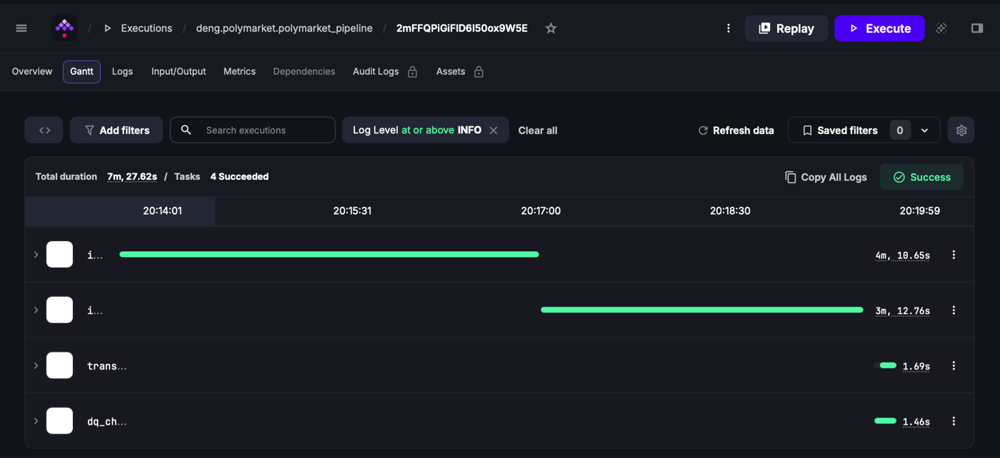

# Polymarket Calibration Pipeline

[](https://github.com/danypolgar/deng/actions/workflows/ci.yml)

**DENG HS26 · Team 04 · Yazdan Musa & Dániel Polgár**

An end-to-end batch data pipeline that ingests resolved Polymarket prediction markets and their price history and builds curated tables for **calibration research**. The midterm version runs locally (Docker Compose, Kestra, PostgreSQL). The final version moves storage and transformations to Google Cloud (GCS, BigQuery).

**Reviewers:** go straight to [9. Setup and verification](#9-setup-and-verification). A full run takes about 10 minutes and needs only Docker.

**Contents:** [1. Use case](#1-problem-and-use-case) · [2. Data source](#2-data-source) · [3. Scope](#3-scope) · [4. Architecture v0.1](#4-architecture-v01-initial-plan) · [5. Architecture v0.2](#5-architecture-v02-midterm) · [6. Data model](#6-data-model) · [7. Plan](#7-project-plan--backlog) · [8. Challenges](#8-anticipated-challenges) · [9. Setup and verification](#9-setup-and-verification) · [10. Repository](#10-repository-structure) · [11. Limitations](#11-known-limitations)

---

## 1. Problem and use case

**Question:** When a prediction market prices an event at x%, does that event actually happen about x% of the time?

In a perfectly calibrated market, events priced at x% happen x% of the time. Deviations show *where* markets are biased. We measure this in 10% price buckets and look for:

- **favourite-longshot bias:** unlikely outcomes are overpriced
- **category effects:** politics vs. crypto vs. economics
- **horizon effects:** 30 days vs. 1 day before close

**End user:** An analyst or researcher studying prediction-market efficiency and bias.

**Data product:**
1. **`fct_market_snapshot`**: one row per resolved market per horizon (30, 7 and 1 days before close). It holds the implied probability at that point and the actual outcome. This is the core table for calibration analysis and optional ML modelling (predicting resolution).
2. **`mart_calibration_summary`**: calibration by probability bucket × category × horizon (market count, mean implied probability, observed frequency, Brier score).
3. Supporting dimension and fact tables (see [Data model](#6-data-model)).

**Example analyst questions**
- Are politics markets better calibrated than crypto markets?
- Does calibration improve as close approaches (30d → 7d → 1d)?
- Are low-probability outcomes (< 10%) systematically overpriced?
- Is calibration better for high-volume markets?

---

## 2. Data source

| Property | Details |
|---|---|
| **Provider** | [Polymarket](https://polymarket.com), a blockchain-based prediction market |
| **Access** | Public REST APIs. No authentication or API key is required. |
| **Gamma API** | `https://gamma-api.polymarket.com`: market and event metadata, categories/tags, volume, dates, resolution status and final outcome prices (`/markets`, `/events`) |
| **CLOB API** | `https://clob.polymarket.com`: historical price series per outcome token (`/prices-history?market=<token_id>&interval=max&fidelity=1440`) |
| **Format** | JSON. Some fields (`outcomes`, `outcomePrices`, `clobTokenIds`) are JSON-encoded strings inside JSON. |
| **Update frequency** | Markets resolve continuously. We only need **closed** markets, so a **daily** batch is sufficient. |
| **Volume (measured)** | One 30-day backfill (measured 2026-10-24): **~8,700 closed markets** (≈ 290/day, after the API pre-filter on volume and start date), **~920 in scope**, **~97,000 daily price points** (≈ 106/market), **~2,700 snapshot rows**, **~50 MB** in PostgreSQL. 12 months would be roughly 100k markets and 1.2M price points, which is still small. |
| **Licence / terms** | Public data. We respect rate limits and do not redistribute raw dumps in this repo. |

### Example records

Gamma `/markets` (trimmed):
```json
{
  "id": "253591",
  "question": "Will Donald Trump win the 2024 US Presidential Election?",
  "conditionId": "0xdd22...0917",
  "startDate": "2024-01-04T22:58:00Z",
  "endDate": "2024-11-05T12:00:00Z",
  "closedTime": "2024-11-06 15:17:41+00",
  "closed": true,
  "outcomes": "[\"Yes\", \"No\"]",
  "outcomePrices": "[\"1\", \"0\"]",
  "volumeNum": 1531479284.50,
  "clobTokenIds": "[\"2174...6455\", \"4833...5732\"]",
  "umaResolutionStatus": "resolved",
  "events": [{ "id": "903193", "slug": "presidential-election-winner-2024", "...": "..." }]
}
```

CLOB `/prices-history`:
```json
{ "history": [ { "t": 1704412803, "p": 0.5 }, { "t": 1704499202, "p": 0.405 } ] }
```

### Data-quality risks

| Risk | Mitigation |
|---|---|
| Nested JSON-encoded string fields | Parse explicitly in staging and validate the array lengths |
| Ambiguous or disputed resolutions (e.g. 50/50 payouts, `umaResolutionStatus` ≠ `resolved`) | Keep only markets with a clean 0/1 outcome and flag the rest |
| Missing or sparse price history (illiquid markets) | Minimum-volume filter. The snapshot uses the last known price at or before the horizon, with a max staleness threshold. |
| `endDate` ≠ actual `closedTime` (early resolution) | Define horizons relative to `closedTime`, document the choice, and keep both |
| Inconsistent categories/tags | Map tags to a small controlled category set (politics, crypto, economics); markets with none of these tags are excluded |
| Multi-outcome events (neg-risk groups) | Treat each binary Yes/No market as its own row and keep `event_id` for grouping |
| Price-history API quirks (e.g. explicit `startTs`/`endTs` windows can return empty results) | Use `interval=max` with daily fidelity and filter the time range downstream |
| API rate limits and transient errors | Retries with exponential backoff, request throttling and idempotent writes |
| Gamma offset paging is capped at ~2,000 rows; the keyset endpoint returns sporadic HTTP 500s (found during implementation) | Page with `/markets/keyset` (cursor), page size 100, retries on 5xx |
| Requests without a `User-Agent` header get HTTP 403 from Cloudflare | The HTTP client always sends a `User-Agent` |
| Survivorship / look-ahead bias | Snapshot prices only use data strictly before the horizon timestamp |

---

## 3. Scope

- **Markets:** closed, binary (Yes/No) markets
- **Time window:** markets closed in the **last 30 days** (initial backfill, configurable via `LOOKBACK_DAYS`), then **daily** incremental loads. Reduced from 12 months in v0.1 so that a reviewer can reproduce the backfill in a few minutes.
- **Filters:** above a minimum volume (initially **$10k**, tunable) and open for **≥ 30 days** (so every horizon exists)
- **Categories:** only **politics, crypto, economics**, assigned from the market's tags (`staging.tag_category`). Markets with none of these tags (e.g. AI/tech, culture, weather) are excluded as `out_of_scope_category`. **Sports are excluded** explicitly (very high count, short-lived markets).
- **Horizons:** 30, 7 and 1 days before close

---

## 4. Architecture v0.1 (initial plan)


Solid = planned final cloud path, dashed = local/midterm path. Source: [`docs/architecture-v0.1.mmd`](docs/architecture-v0.1.mmd).

> This section is the **original plan** from the initial pitch and is kept unchanged for comparison. Several points (12-month backfill, load-date partitions, `MERGE`) were changed during implementation. See [section 5](#5-architecture-v02-midterm) for what we built and why.

**Pipeline steps**
1. **Ingest markets:** page through Gamma `/markets` for closed markets in the load window, apply scope filters, and write the raw JSON pages.
2. **Ingest price history:** for each new market, fetch the daily price series of the **Yes** token from the CLOB API and write the raw JSON.
3. **Land raw data:** midterm: PostgreSQL (`raw` schema, JSONB). Final: GCS at `gs://<bucket>/raw/{markets|prices}/load_date=YYYY-MM-DD/…`, written directly without depending on local storage.
4. **Transform:** parse, type and deduplicate in staging, then build dimensions, facts, snapshots and marts.
5. **Quality checks:** uniqueness, not-null, accepted values, price in [0, 1], and horizon timestamps before close.
6. **Serve:** curated BigQuery tables queried by the analyst.

**Ingestion strategy**
- **Initial backfill:** 12 months of closed markets
- **Daily incremental:** markets whose `closedTime` falls in the previous day (high-water mark on `closedTime`). Price history is fetched only for new markets, because resolved markets no longer change.
- **Idempotency:** raw data is partitioned by load date. Reloads overwrite a partition, and downstream tables are rebuilt with `MERGE` on `market_id`, so reruns do not create duplicates.
- **Failure behaviour:** per-request retries with backoff. A failed market is logged and retried on the next run without blocking the whole batch.

### Technology choices

| Layer | Local (midterm) | Cloud (final) |
|---|---|---|
| Ingestion | Python (`requests`) | Python (`requests`) |
| Data lake | – | Google Cloud Storage |
| Storage / warehouse | PostgreSQL | BigQuery |
| Transformation | SQL | dbt + BigQuery |
| Orchestration | Kestra | Kestra |
| Infrastructure | Docker Compose | Terraform (GCS bucket, BigQuery datasets, service account) |

---

## 5. Architecture v0.2 (midterm)


Solid = implemented (midterm, local Docker Compose). Dashed = planned for the final (GCP). Source: [`docs/architecture-v0.2.mmd`](docs/architecture-v0.2.mmd). Both diagrams are rendered to SVG with [Pele](https://github.com/kepano/pele).

Every Kestra task starts a container from the same image, `deng-pipeline:latest` (Kestra **Docker task runner**), and runs one CLI command: `python -m polymarket_pipeline <ingest-markets|ingest-prices|transform|dq-check>`. The same commands can be run by hand with `docker compose run`, which makes each step testable without the orchestrator.

### Changes since v0.1

| Area | v0.1 plan | v0.2 (implemented) | Why |
|---|---|---|---|
| Schedule | daily | **daily** (02:00 UTC), incremental | Unchanged. During development we tried every 5 minutes: 288 runs/day, most loading 0 markets. The analysis uses daily prices and day-based horizons, and only ~30–40 in-scope markets close per day, so fresher data changes no result. A daily run also gives new markets a few hours to settle disputes. |
| Initial backfill | 12 months | **30 days** (`LOOKBACK_DAYS`) | A reviewer can reproduce the backfill in 6–8 minutes (~1,000–1,300 API calls instead of ~15,000) |
| Incremental key | `closedTime` of the previous day | **watermark** = end of the last successful market window (`raw.ingestion_log`), minus a 15-minute overlap | Independent of the schedule: missed or failed runs are covered by the next run; the overlap catches markets that show up in the API late |
| Gamma paging | `/markets` with offset | `/markets/keyset` with cursor | Offset paging is capped at ~2,000 rows (a 30-day backfill has 7,400–8,700) |
| Raw landing | JSONB partitioned by load date | JSONB keyed by `market_id` (upsert), plus `run_id` and `ingested_at` | Idempotency through the natural key is simpler in PostgreSQL; load-date partitioning returns with GCS in the final |
| Scope filtering | in the ingestion script | coarse pre-filter in the API call (volume, start date); exact rules in `staging.stg_markets` with an `exclusion_reason` | One place for the rules, raw keeps everything (re-filtering needs no re-download), exclusions are explainable |
| Category scope | mainly politics, crypto, economics; `other` as catch-all | **only** politics, crypto, economics; `other` excluded (`out_of_scope_category`) | Team decision: keeps the analysis focused on the three categories of the research questions; costs ~16% of the markets (mostly AI/tech) |
| Transformation | SQL / dbt | plain SQL files, executed by the pipeline image; full rebuild of marts in one transaction | Data is small (~2,700–3,100 snapshot rows); dbt is planned for BigQuery |
| Data quality | planned for the final | `marts.dq_results` view (error / warn), checked as the last task | Cheap to add now and it protects the core table |
| Tests | not planned | unit tests + SQL integration tests on fixture data, run by GitHub Actions on every push | The snapshot rules (no look-ahead, staleness, buckets) are easy to break silently. A test fails if they change. |
| Scope thresholds | hard-coded | defined once in `config.py`, written to `staging.scope_settings` before every command | The API pre-filter and the SQL scope rules can no longer disagree |

### Docker setup

| Practice | Implementation | Why |
|---|---|---|
| Reproducible images | Base images pinned by digest (multi-arch: arm64 and amd64). Python dependencies installed from `requirements.lock` with exact versions and `--no-deps`, checked with `pip check`. | Every reviewer and CI run gets the same bits. A new upstream release cannot break the build. |
| Small runtime image | Multi-stage build: dependencies go into a venv in a `build` stage; only the venv, code and SQL are copied into `runtime`. The venv has no pip. | Fewer packages, less to patch, 227 MB. |
| Separate test image | `test` stage = runtime + pytest + tests, started with `docker compose run --rm test`. | Production image contains no test code or test tools. |
| No root | Runtime runs as fixed uid/gid `10001`. Code and SQL are owned by root and read-only for that user. | A bug in the pipeline cannot change its own code. |
| Hardened one-shot containers | `read_only: true`, `tmpfs: /tmp`, `cap_drop: [ALL]`, `no-new-privileges` for `pipeline` and `test`. | The pipeline only needs the network and the database. |
| Least-privilege config | Pipeline containers receive only the 5 database settings and `DOH_URL`, not the whole `.env` (no Kestra passwords). | Each container sees only the secrets it needs. |
| Network isolation | `kestra-postgres` is on an internal network that only Kestra can reach. | Task containers cannot read or change Kestra's metadata DB. |
| Ports on localhost only | `127.0.0.1:8080` and `127.0.0.1:5433`. | Kestra and PostgreSQL are not reachable from other computers on the network. |
| Health checks and startup order | PostgreSQL: `pg_isready`. Kestra: `/health` on its management port. `depends_on` waits for healthy DBs and a successful `init-db`. | `docker compose ps` shows `healthy` when the stack is ready. Nothing starts against a DB that is not up. |
| Clear errors | Required `.env` values use `${VAR:?message}`. | Without `.env`, Compose stops with `set PG_DATABASE in .env (cp .env.example .env)` instead of starting with empty passwords. |
| Small build context | `.dockerignore` is an allowlist. | `.git`, `.env`, docs and data never go into the build. |
| Operations | Log rotation (10 MB × 3), `restart: unless-stopped` for long-running services, graceful stop periods. | Logs cannot fill the disk; the stack survives a Docker restart. |
| Checked in CI | hadolint on the Dockerfile, `docker compose config`, image build, and the full test suite inside the compose stack. | A broken Docker setup fails the build before a reviewer sees it. |

### Ingestion design

| Concern | Implementation |
|---|---|
| **Modularity** | `http_client.py` (throttling, retries), `doh.py` (DNS-over-HTTPS for the API hosts), `gamma.py` (markets), `clob.py` (prices), `db.py` (all SQL access), `cli.py` (commands) |
| **Full vs. incremental** | Incremental by default. The first run has no watermark and therefore backfills `LOOKBACK_DAYS`. Closed markets do not change, so a full reload is never needed. |
| **Load window** | `ingest-markets` loads markets with `window_start ≤ closedTime < window_end`, paging newest-first and stopping at the first page older than the window. |
| **Idempotency** | `raw.markets` upserts on `market_id`; `raw.price_history` replaces one row per market; marts are rebuilt from staging. Running the same window twice gives the same tables. |
| **Price step** | Without a window: fetches every in-scope market that has **no price history yet**, plus markets whose history came back **empty** (up to 3 attempts, counted in `raw.price_history.fetch_attempts`). This is self-healing: a market that failed is retried by the next run. With a window: refetches all in-scope markets closed in that window. |
| **Failure behaviour** | HTTP 429/5xx: up to 6 retries with exponential backoff inside the client. One failing market is logged and skipped (`status = partial`); the task fails only if every market failed. Kestra retries the API tasks up to 3 times (exponential, 30 s → 5 min). A failed DQ check fails the execution without retry. |
| **Concurrency** | Kestra `concurrency.limit: 1` (queue): a long backfill and a scheduled run never write at the same time. |
| **Observability** | Every step writes a row to `raw.ingestion_log` (run id = Kestra execution id, window, fetched / loaded / failed counts). |

### Transformations and why they are needed

1. **`staging.stg_markets` (view)**: parses the JSON-encoded string fields (`outcomes`, `outcomePrices`, `clobTokenIds`), types the timestamps, derives `outcome` (1 = Yes, 0 = No, null = not a clean resolution), maps free-form tags to the controlled categories through `staging.tag_category` (priority crypto > economics > politics; no matching tag = `other`), and applies the scope rules from section 3. Each excluded market gets an `exclusion_reason` (`not_binary_yes_no`, `sports`, `out_of_scope_category`, `unclean_resolution`, `low_volume`, `open_less_than_30_days`, …).
2. **`staging.stg_price_history` (view)**: one row per market × price point, from the CLOB JSON array.
3. **`marts.fct_market_snapshot` (table)**: the core transformation for the use case. Calibration compares the **implied probability at a fixed time before close** with the **outcome**, but every market has its own irregular price series. The snapshot aligns all markets to the same three horizons (30 / 7 / 1 days before `closedTime`) and takes the **last price strictly before the horizon** (no look-ahead). Prices more than 3 days older than the horizon count as missing (illiquid market), and that market × horizon row is left out. The prob bucket (10% steps) and the squared error are precomputed for the summary.
4. **`marts.mart_calibration_summary` (view)**: market count, mean implied probability, observed frequency, calibration gap and Brier score per category × horizon × bucket, plus pooled `category = 'all'` rows. It directly answers the analyst questions in section 1.

---

## 6. Data model

| Table | Grain (one row = …) | Purpose | Status |
|---|---|---|---|
| `raw.markets` | one Gamma market (latest version) | Unchanged source record (JSONB) | ✅ midterm |
| `raw.price_history` | one market | Unchanged CLOB price series of the Yes token (JSONB) | ✅ midterm |
| `raw.ingestion_log` | one pipeline step execution | Run log and incremental watermark | ✅ midterm |
| `staging.stg_markets` | one market | Parsed, typed, categorised, scope decision | ✅ midterm |
| `staging.stg_price_history` | one market × price point | Typed price series | ✅ midterm |
| `marts.fct_market_snapshot` | one in-scope market × one horizon (30/7/1 days) | Implied probability at the horizon plus the outcome. Core table for calibration and ML. | ✅ midterm |
| `marts.mart_calibration_summary` | one category × horizon × probability bucket | Market count, avg. implied probability, observed frequency, Brier score | ✅ midterm |
| `marts.dq_results` | one data-quality check | Failing-row count and severity | ✅ midterm |
| `dim_event` | one Polymarket event | Groups related markets, holds category and tags | final |
| `dim_market` | one binary market | Question, dates, volume, category, resolved outcome (0/1) | final |
| `fct_price_daily` | one market × one day | Daily Yes-token price (implied probability) | final |

Partitioning and clustering (final): `fct_price_daily` is partitioned by `price_date` and clustered by `market_id`. `fct_market_snapshot` is clustered by `category, horizon_days`.

---

## 7. Project plan / backlog

| Week | Milestone | Tasks |
|---|---|---|
| 3 (01.10) | **Initial pitch** | README, use case, data-source analysis, Architecture v0.1, backlog |
| 4 | | Python ingestion for Gamma + CLOB, PostgreSQL schema, Docker Compose |
| 5 | | Kestra flow: schedule, retries, backfill by date parameter |
| 6 (22.10) | **Midterm submission** | First transformation (`fct_market_snapshot` in Postgres), Architecture v0.2, setup and verification docs |
| 8–10 | | Terraform (GCS, BigQuery, service account), cloud ingestion direct to GCS |
| 11 | | BigQuery external/native tables, partitioning and clustering |
| 12 | | dbt models (staging → dims/facts → marts), tests, docs |
| 13 (10.12) | **Final submission** | Data-quality checks, safe reruns, final architecture, verification queries, known limitations |

---

## 8. Anticipated challenges

- Correctly determining the **resolved outcome** and handling disputed or voided markets
- Choosing a **consistent close timestamp** for horizon calculation
- **Sparse prices** for low-liquidity markets at the 30-day horizon
- **Category mapping** from free-form tags
- **Rate limits** during the initial backfill (one price-history request per market)
- **Sample size:** the calibration buckets need enough markets per category × horizon to be meaningful

---

## 9. Setup and verification

The procedures in this section use ASD-STE100 style: one action for each step, followed by the result.

### 9.1 Prerequisites

Make sure that you have:

- Docker Desktop (macOS, or Windows with WSL2), or Docker Engine with Compose v2.
- Approximately 4 GB of free RAM.
- Free ports **8080** (Kestra) and **5433** (PostgreSQL). You can change these ports in `.env`.
- An internet connection.

You do not need:

- API keys or cloud credentials.
- A VPN in Switzerland. The pipeline gets around the Swiss DNS block itself (see [Known limitations](#11-known-limitations)).

> **Note:** In Switzerland, `curl` to the Polymarket API can fail on your computer. The pipeline still works. This is expected.

### 9.2 Start the environment

1. Clone the repository:
   ```bash
   git clone <repo-url>
   cd deng
   ```
2. Make the configuration file:
   ```bash
   cp .env.example .env
   ```
   You can change the passwords in `.env`. This is optional.
3. Build and start all services:
   ```bash
   docker compose up -d --build
   ```
   **Result:** Docker builds the image `deng-pipeline:latest` and starts PostgreSQL and Kestra. The `pipeline` service creates the database schemas and stops with exit code 0. This is correct.
4. Wait approximately 30 seconds. Kestra must start completely.

### 9.3 Run the pipeline

1. Open **http://localhost:8080** in a browser.
   **Result:** The Kestra login page opens.
   > **Note:** If the page shows `404 page not found`, another program uses port 8080. Do the steps in [Troubleshooting](#99-troubleshooting).
2. Log in with the values from `.env`:
   - Email: `KESTRA_USER` (default `admin@kestra.io`)
   - Password: `KESTRA_PASSWORD` (default `ChangeMe123`)
3. In the left menu, click **Flows**.
4. Click the flow **`polymarket_pipeline`** (namespace `deng.polymarket`).
5. Click **Execute**.
6. Keep the two inputs `window_start` and `window_end` empty.
7. Click **Execute** again.
   **Result:** The first execution starts. This execution is the 30-day backfill.
8. Wait 6 to 8 minutes.
   > **Note:** Most of this time is approximately 1,000 price-history requests. Later executions are incremental and take 10 to 20 seconds.
9. Make sure that all 4 tasks show `SUCCESS`:
   `ingest_markets` → `ingest_prices` → `transform` → `dq_check`
10. Optional: Open the **Logs** tab of `dq_check`.
    **Result:** Each check shows `PASS` or `WARN`. No check shows `FAIL`.

> **Note:** The schedule runs the pipeline each day at 02:00 UTC. For this reason, you must start the first execution manually.



*Reference run, 2026-10-24: first execution (30-day backfill), all 4 tasks succeeded in 7 m 28 s. Task order top to bottom: `ingest_markets`, `ingest_prices`, `transform`, `dq_check`.*

### 9.4 Rerun or backfill a time window

1. In Kestra, open the flow **`polymarket_pipeline`**.
2. Click **Execute**.
3. Set `window_start`. Example: `2026-10-10T00:00:00Z`.
4. Set `window_end`. Example: `2026-10-12T00:00:00Z`.
5. Click **Execute** again.
   **Result:** The pipeline reads the markets that closed in this window again. It gets their price histories again and rebuilds the marts.
6. Do query 5 in [9.7](#97-verify-the-data) before and after the rerun.
   **Result:** The row counts are the same. Each write is an upsert or a replace, so a rerun does not make duplicates.

### 9.5 Recover a failed execution

Do one of these steps:

- In the Kestra execution, click **Restart**. Kestra runs the failed task again.
- Wait for the next scheduled run. It starts from the last successful watermark and gets the missing price histories.

### 9.6 Run the steps without Kestra (optional)

You can run each step manually. The steps use the same image and the same commands as Kestra:

```bash
docker compose run --rm pipeline python -m polymarket_pipeline ingest-markets --start 2026-10-10 --end 2026-10-12
docker compose run --rm pipeline python -m polymarket_pipeline ingest-prices  --start 2026-10-10 --end 2026-10-12
docker compose run --rm pipeline python -m polymarket_pipeline transform
docker compose run --rm pipeline python -m polymarket_pipeline dq-check
```

### 9.7 Verify the data

1. Open a SQL shell:
   ```bash
   docker compose exec postgres psql -U polymarket -d polymarket
   ```
   > **Note:** You can also use a SQL client. Connect it to `localhost:5433` with the credentials from `.env`.
2. Do the 7 queries below. Compare each result with the expected result in the comment.

```sql
-- 1. Run log: one row per step and execution, newest first. Expect status = success.
select run_id, step, status, window_start, window_end, records_fetched, records_loaded, records_failed, finished_at
  from raw.ingestion_log order by log_id desc limit 12;

-- 2. Raw data loaded. Expect several thousand markets and ~1,000 price histories after the backfill.
select (select count(*) from raw.markets) as markets, (select count(*) from raw.price_history) as price_histories;

-- 3. Scope decisions. Expect in_scope (exclusion_reason null) ~1,000; the rest excluded with a reason.
select coalesce(exclusion_reason, '(in scope)') as reason, count(*) from staging.stg_markets group by 1 order by 2 desc;

-- 4. Core table: rows per category (politics, economics, crypto) and horizon (~2,700–3,100 rows in total).
select category, horizon_days, count(*) from marts.fct_market_snapshot group by 1, 2 order by 1, 2;

-- 5. Grain / idempotency: both numbers must be equal, before and after a rerun.
select count(*) as rows, count(distinct (market_id, horizon_days)) as distinct_keys from marts.fct_market_snapshot;

-- 6. Data-quality checks: every 'error' check must have failing_rows = 0.
select * from marts.dq_results order by severity, check_name;

-- 7. The analyst's view: calibration 7 days before close, all categories.
select prob_bucket, market_count, mean_implied_prob, observed_frequency, calibration_gap, brier_score
  from marts.mart_calibration_summary
 where category = 'all' and horizon_days = 7 order by prob_bucket;
```

The numbers change with the day of the backfill. Our two reference runs:

| Run date | Duration | Raw markets | In scope | Snapshot rows | Error checks | Rerun 10.10 → 12.10 |
|---|---|---|---|---|---|---|
| 2026-10-20 | ~6 min | 7,363 | 1,037 | 3,075 | all `PASS` | counts unchanged |
| 2026-10-24 (macOS) | ~7.5 min | 8,734 | 919 | 2,719 | all `PASS` | counts unchanged |

### 9.8 Run the tests

1. Run this command:
   ```bash
   docker compose run --rm test
   ```
   **Result:** `25 passed`. 12 are unit tests. 13 are SQL integration tests: they make a temporary database, load fixture markets with known correct results, run the real SQL files and delete the database after the test.

> **Note:** The `test` service uses the `test` stage of the Dockerfile (runtime image + pytest + tests). `docker compose up` does not start it.

> **Note:** The SQL integration tests check the scope rules, the no-look-ahead rule, the 3-day staleness limit, the buckets, the DQ checks, idempotency and the retry of empty histories. If you change one of these rules, a test fails. GitHub Actions runs all tests on each push (see the CI badge at the top).

> **Note:** You can also run the tests locally with Python 3.12:
> `pip install -r ingestion/requirements-dev.txt && cd ingestion && python -m pytest`

### 9.9 Troubleshooting

| If | Then |
|---|---|
| A Kestra task shows `No such image: deng-pipeline:latest` | Run `docker compose build pipeline`. |
| Docker shows `port is already allocated` | Change `KESTRA_HOST_PORT` or `PG_HOST_PORT` in `.env`. Run `docker compose up -d`. |
| The Kestra page shows `404 page not found` | Another program uses port 8080. Set `KESTRA_HOST_PORT=8088` in `.env`. Run `docker compose up -d`. Open http://localhost:8088. |
| `ingest_markets` shows connection timeouts | Make sure that your network allows HTTPS to `1.1.1.1`. If it does not, set `DOH_URL=` (empty) in `.env` and use a VPN. |
| Kestra does not show a change in `orchestration/flows/` | Run `docker compose restart kestra`. Kestra reads the flows only when it starts. |

### 9.10 Stop or reset

- To stop and keep the data:
  ```bash
  docker compose down
  ```
- To stop and delete all data:
  ```bash
  docker compose down -v
  ```
  > **Caution:** This deletes all data. The next start does the 30-day backfill again.

---

## 10. Repository structure

```
.
├── README.md
├── docs/                       # architecture diagrams (.mmd source + .svg), screenshots
├── .github/workflows/ci.yml    # GitHub Actions: tests with a Postgres service, Docker build
├── docker-compose.yml          # postgres, pipeline (image + init-db), kestra, kestra-postgres, test (profile)
├── .dockerignore               # allowlist: only code, SQL and requirements go into the build
├── .env.example                # configuration template (no secrets committed)
├── ingestion/
│   ├── Dockerfile              # multi-stage: build (venv) → runtime (deng-pipeline:latest) → test
│   ├── requirements.txt        # direct dependencies
│   ├── requirements.lock       # all dependencies, exact versions (installed by the image)
│   ├── requirements-dev.txt
│   ├── polymarket_pipeline/    # Python package (CLI: python -m polymarket_pipeline)
│   │   ├── cli.py              # commands, load-window logic
│   │   ├── config.py           # settings from environment variables
│   │   ├── http_client.py      # throttled session with retries
│   │   ├── doh.py              # DNS-over-HTTPS for the API hosts (Swiss DNS block)
│   │   ├── gamma.py            # Gamma API: closed markets (keyset paging)
│   │   ├── clob.py             # CLOB API: price history
│   │   └── db.py               # PostgreSQL access
│   └── tests/                  # unit tests + SQL integration tests (see 9.8)
├── transformations/sql/
│   ├── 00_raw.sql              # schemas, raw tables, ingestion log
│   ├── 10_staging.sql          # tag → category map, staging views, scope rules
│   ├── 20_fct_market_snapshot.sql
│   ├── 30_mart_calibration_summary.sql
│   └── 40_dq_checks.sql
├── orchestration/flows/
│   └── polymarket_pipeline.yml # Kestra flow: schedule, retries, backfill inputs
└── terraform/                  # GCP infrastructure (final milestone, not created yet)
```

## 11. Known limitations

- **Access from Switzerland:** Swiss ISPs (e.g. Swisscom) block `*.polymarket.com` via DNS under the Swiss Gambling Act. The pipeline works around this without a VPN:
  - `doh.py` resolves only the two API hosts through DNS-over-HTTPS (`DOH_URL`, default Cloudflare `1.1.1.1`).
  - TLS still checks the real `polymarket.com` certificate. If DoH is unreachable, the normal DNS is used.
  - Tested with Swisscom DNS (`--dns 195.186.1.111`): without DoH the host resolves to the block page, with DoH the API answers.
  - Set `DOH_URL=` (empty) in `.env` to turn it off.
- **Single platform:** markets are one platform's view (Polymarket only). Results may not generalise to other prediction markets.
- **Daily prices:** calibration is measured on daily prices (`fidelity=1440`), not intraday prices.
- **Close vs. resolution:** horizons are measured from `closedTime`. Many markets are effectively decided before they close (prices already near 0 or 1), so the 1-day horizon looks very well calibrated; the 7- and 30-day horizons are more informative.
- **Small sample:** 30 days give ~1,000 markets (crypto only ~60). Several category × horizon × bucket cells have fewer than 30 markets and should not be over-interpreted. A longer `LOOKBACK_DAYS` gives more data at the cost of a longer backfill.
- **Narrow topic scope:** sports and every market outside politics, crypto and economics are excluded (~16% of the otherwise in-scope markets, mostly AI/tech). The category comes from a hand-maintained tag list, so a relevant market with an unmapped tag is excluded too; check `staging.stg_markets where exclusion_reason = 'out_of_scope_category'`.
- **Corrections after close:** incremental runs read markets by close time. A market that is changed after it closed (e.g. a disputed resolution) is only picked up by an explicit rerun of its window.
- **Empty price histories:** an in-scope market whose CLOB history is empty is fetched again by the next runs, at most 3 times in total. After that it stays empty and the `in_scope_market_with_empty_price_history` warning reports it.
- **Full rebuild of the marts** on every run: fine at this size (~1 s); the BigQuery version will use incremental `MERGE`.
- **Local security setup:** Kestra runs as root to use the Docker socket, which gives it control over the host's Docker. Database passwords reach the task containers as Kestra environment variables, and the Kestra login is a basic-auth user from `.env`. This is acceptable for a local development setup, not for production (see [Docker setup](#docker-setup) for what we hardened).
- **Kestra 2.0 syntax:** flow-level `pluginDefaults` and YAML anchors are not supported, so the shared task settings are repeated in each of the four tasks.
